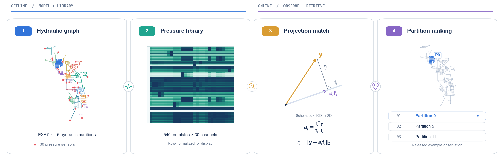
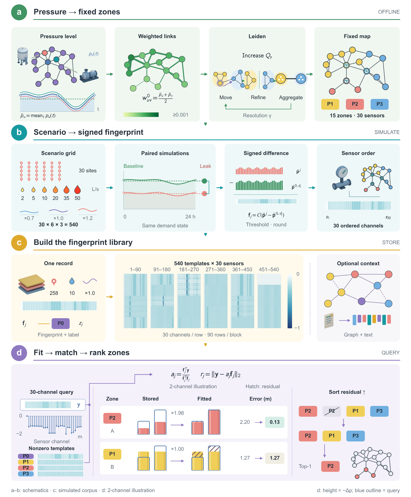
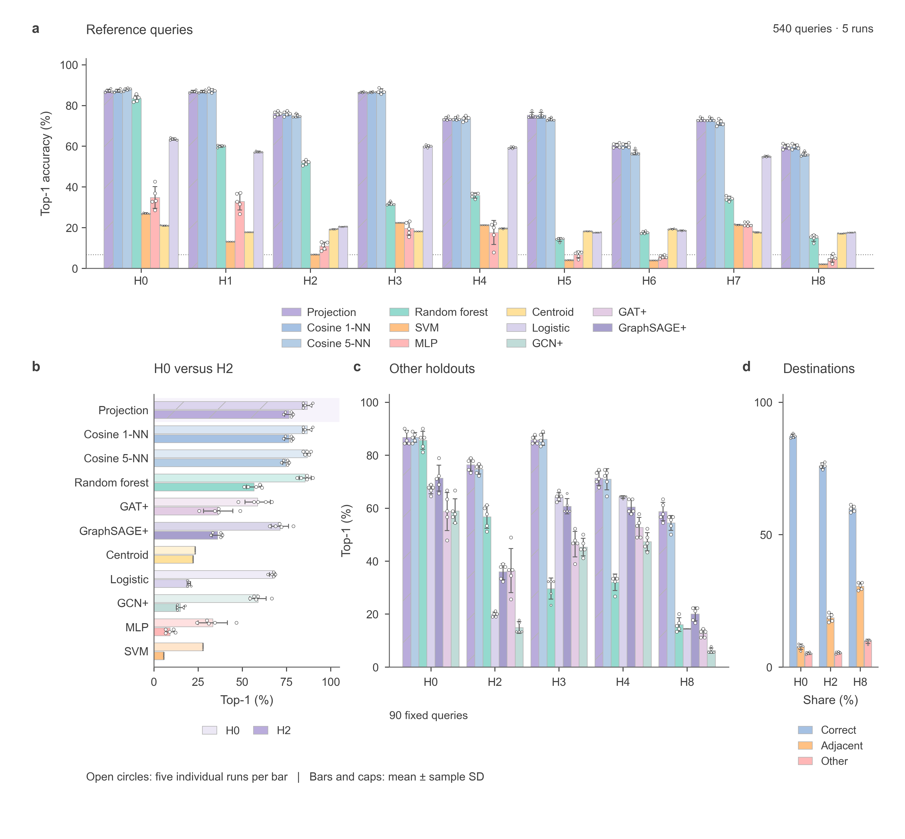
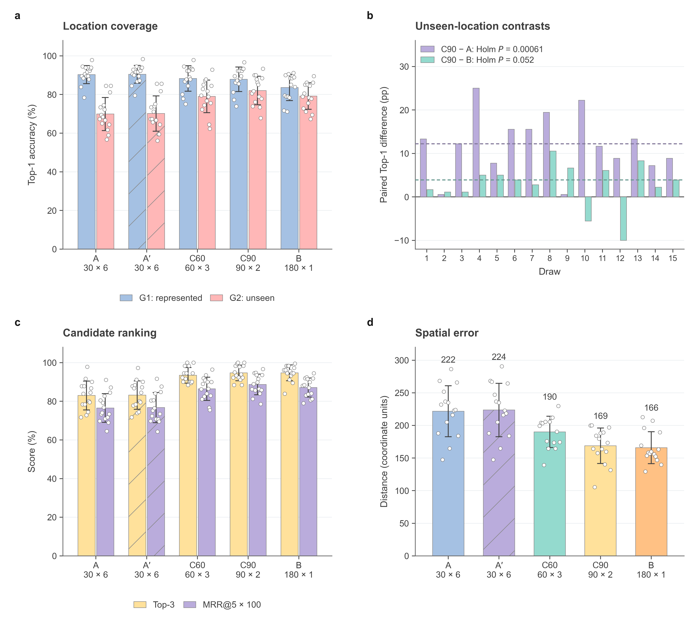

<div align="center">

# TS-GraphRAG

### Physics-grounded scenario retrieval for leak localization

**From sparse pressure measurements to ranked leak regions.**

[](https://github.com/mutianwei521/TS-GraphRAG/actions/workflows/reproducibility.yml) [](https://github.com/mutianwei521/TS-GraphRAG/releases/tag/v1.0.1-resubmission) [](environment.yml) [](LICENSE)

[Overview](#overview) · [Method](#method) · [Quick start](#quick-start) · [Results](#results) · [Reproduction](#reproduction) · [Citation](#citation)

<a href="docs/assets/teaser.pdf">
  
</a>

*Hydraulic structure → scenario fingerprints → amplitude fitting → region ranking.*

</div>

## Overview

TS-GraphRAG turns hydraulic simulations into a searchable library for **partition-level leak localization**. An observation is matched to stored pressure responses through a closed-form projection step that fits the response amplitude and ranks candidate regions. The numerical inference path runs directly on the CPU.

- **A physical representation.** Pressure-informed graph partitions connect the network topology, sensor layout and simulated leak responses in one scenario library.
- **A direct matching rule.** Projection residuals match the shape of a pressure response while fitting its amplitude; scenario matches become a ranked list of distinct regions.
- **Controlled retrieval evaluation.** H0–H9 protocols control which leak locations, rates and demand states are represented in the reference library. Fixed-budget experiments examine how scenario allocation affects unseen-location retrieval.

<div align="center">

| Hydraulic regions | Ordered sensors | Reference templates | Demand states |
|:---:|:---:|:---:|:---:|
| **15** | **30** | **540** | **3** |

</div>

## Method

1. **Partition the network.** Use pressure-weighted links and Leiden community detection to define hydraulic regions, then fix the observation sensors.
2. **Build the library.** Pair baseline and leak simulations in each demand state; encode their signed pressure differences in a consistent sensor order.
3. **Fit and retrieve.** For observation $y$ and eligible nonzero fingerprint $f_j$, compute

$$
\hat a_j = \frac{f_j^\mathsf{T}y}{f_j^\mathsf{T}f_j},
\qquad
r_j = \lVert y-\hat a_j f_j\rVert_2.
$$

4. **Rank leak regions.** Sort templates by increasing residual and retain each region's first occurrence.

The released primary mode uses projection-residual retrieval. Graph and semantic fusion, physical-dictionary estimators and language-model re-ranking have separate experiment paths in the [study guide](docs/REPRODUCIBILITY.md).

<details>
<summary><strong>Explore the full methodology figure</strong></summary>

<p align="center">
  <a href="docs/assets/methodology.png"></a>
</p>

The paper's method figure shows the released EXA7 design and complete 540 × 30 fingerprint matrix. The two-channel projection geometry is a schematic explanation of the matching rule.

</details>

## Quick start

### Install and run an example

```bash
git clone https://github.com/mutianwei521/TS-GraphRAG.git
cd TS-GraphRAG
conda env create -f environment.yml
conda activate ts-graphrag-repro

python main.py --mode inference --observations data/example_observation.csv
```

The example returns the predicted region, complete region ranking and ordered scenario matches. Selected output fields are:

```json
{
  "method": "projection",
  "predicted_partition": 0,
  "top3_partitions": [0, 5, 11]
}
```

Input observations are leak-minus-baseline pressure changes in metres, in the released 30-sensor order. See [input formats and configuration](docs/REPRODUCIBILITY.md#input-verification-and-a-first-inference) for your own observations.

<details>
<summary><strong>Use a Python virtual environment</strong></summary>

With Python 3.11 installed:

```bash
python -m venv .venv
```

Activate with `.venv\Scripts\Activate.ps1` on Windows or `source .venv/bin/activate` on Linux/macOS, then install:

```bash
python -m pip install -r requirements-core.lock.txt
```

The full-study reference environment is Windows x64 with Python 3.11.15, WNTR 1.4.0 / EPANET 2.2 and NumPy 2.3.5. Hosted Windows CI uses CPython 3.11.9 with the same package lock. Each validation report identifies its execution environment. Semantic encoding and GNN training have [separately pinned profiles](docs/REPRODUCIBILITY.md#fixed-version-and-environment).

</details>

## Results

### A frozen estimator, evaluated on separate test nodes

The development-selected projection rule reaches **81.11% Top-1 accuracy with the query leak node excluded (H2)**. The split assigns one development node and one test node per partition: 15 nodes per split, 270 scenarios and five Gaussian noise streams (sensor-wise standard deviation **0.02 m**), giving **1,350 test observations per protocol**.

| Test protocol | TS-GraphRAG | Cosine retrieval | Full fusion |
|---|---:|---:|---:|
| H0 · full reference library | 85.70 | 85.70 | **86.67** |
| H2 · leak node excluded | **81.11** | **81.11** | 73.19 |
| H4 · demand state excluded | **73.04** | **73.04** | 58.81 |
| H8 · node, rate and demand state excluded | **65.33** | **65.33** | 46.30 |

Values are Top-1 accuracy (%); bold marks the highest value in each row, including ties. TS-GraphRAG and cosine retrieval produce identical predictions on this frozen test set. [All H0–H8 test results](data/frozen/node_selection/test_results.json), [frozen configuration](data/frozen/node_selection/frozen_config.json), and [split identities](data/frozen/node_selection/split.json) are included in the release.

<details>
<summary><strong>View the repeated classical and graph-neural baseline comparison</strong></summary>

<p align="center">
  <a href="docs/assets/baselines.png"></a>
</p>

This reference benchmark uses five stochastic runs on fixed 540-query and matched 90-query sets. Bars and caps show mean ± sample standard deviation; white circles show the individual runs. It is a separate experiment from the frozen development/test study above. [Configurations and source data](experiments/repeated_benchmarks/README.md).

</details>

### Scenario allocation changes unseen-location performance

With **540 stored templates in every design**, allocating more of the budget to distinct leak locations changes retrieval performance. C90 (90 locations × 2 rates × 3 demand states) exceeds A (30 × 6 × 3) on unseen-location Top-1 accuracy in **all 15 paired draws**, with a median paired gain of **12.2 percentage points** (Holm-adjusted sign-test $P=0.00061$).

<p align="center">
  <a href="docs/assets/allocation.png"></a>
</p>

The allocation study uses 15 corpus/query-location draws and 180 queries per group per draw. White circles show all draw-level observations; error bars show sample standard deviation. Spatial error uses native network-coordinate units. [Experimental design](experiments/allocation/README.md) · [Draw-level data](data/frozen/allocation/e5_h0_draws.csv) · [Paired statistics](data/frozen/allocation/e5_g2_top1_pairwise.csv).

## Reproduction

The [fixed release](https://github.com/mutianwei521/TS-GraphRAG/releases/tag/v1.0.1-resubmission) includes frozen inputs, query identities, seeds, node splits, expected outputs, a **36-sheet Source Data workbook** and **102 figure/table mapping entries**. Independent-clone validation and hosted Windows CI each passed **132 tests**.

```bash
# Check the execution chain, including a real hydraulic simulation
python scripts/reproduce.py --profile smoke --output-dir outputs/smoke
python scripts/verify_outputs.py --run-dir outputs/smoke

# Recompute paper results and figures from their documented frozen inputs
python scripts/reproduce.py --profile replay --study all --output-dir outputs/paper_replay
python scripts/verify_outputs.py --run-dir outputs/paper_replay

# Rebuild the reference library from the EXA7 hydraulic model
python scripts/reproduce.py --profile full --study exa7 --output-dir outputs/exa7
```

`smoke` runs the short execution check. `replay` recomputes predictions, statistics and figures from the released study inputs. `full` executes a study's construction stages. Each study's starting inputs and optional dependencies are specified in the [complete reproduction guide](docs/REPRODUCIBILITY.md).

| Resource | Contents |
|---|---|
| [Reproduction guide](docs/REPRODUCIBILITY.md) | Commands, environments, experiment stages and output contracts |
| [Evaluation protocols](docs/EVALUATION.md) | H0–H9, retained-pool rules, repeat units and ranking metrics |
| [Figure/table map](reproducibility/figure_table_map.csv) | Panel-level links between experiments, data and figures |
| [Source Data](source_data/README.md) | Typed worksheets, CSV exports, table snapshots and figure inputs |
| [Validation evidence](reproducibility/validation_summary.json) | Executed checks, numerical comparisons and supporting reports |
| [Data access and provenance](docs/DATA_ACCESS.md) | Distributed assets, fixed model revision and municipal-model access |

H0 measures noisy closed-world retrieval. H2, H5, H6 and H8 exclude the query leak node; H9 checks represented-label support. These definitions apply throughout the corresponding evaluation paths.

<details>
<summary><strong>Build the workbook or draw figures individually</strong></summary>

```bash
python scripts/build_source_data.py --output outputs/source_data
python scripts/figures/replay.py all --output outputs/figures
python scripts/figures/replay.py S6-standalone --output outputs/figures_s6
```

[Figure sources](scripts/figures/README.md) include the integrated manuscript/SI figures and the separately captioned standalone Fig. S6.

</details>

### Repository layout

```text
TS-GraphRAG/
├── data/             # Hydraulic model, reference design and frozen study inputs
├── src/              # Configuration, inference and evaluation
├── experiments/      # Baselines, holdouts, allocation and robustness studies
├── scripts/          # Reproduction, verification, source data and figure builders
├── source_data/      # Worksheet data and approved paper assets
├── reproducibility/  # Query/split manifests, figure map and validation records
└── docs/             # Guides and visual overview
```

## Citation

Use the software citation in [CITATION.cff](CITATION.cff) for the frozen release:

```bibtex
@software{mu2026tsgraphrag,
  author  = {Mu, Tianwei},
  title   = {{TS-GraphRAG}: Hydraulic scenario retrieval for leak localization},
  year    = {2026},
  version = {1.0.1-resubmission},
  url     = {https://github.com/mutianwei521/TS-GraphRAG/releases/tag/v1.0.1-resubmission}
}
```

## License

The code is released under the [MIT License](LICENSE). Hydraulic simulation uses WNTR / EPANET, and graph partitioning uses Leiden. Data and model provenance accompany their [released assets](docs/DATA_ACCESS.md).
